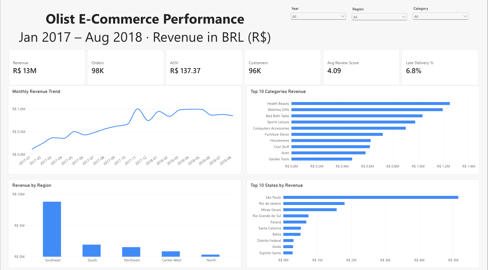

# Olist E-Commerce Performance Dashboard (Power BI + Microsoft Fabric)

An end-to-end analytics project on ~100K real (anonymized) orders from Olist, Brazil's largest department-store marketplace, built entirely in the browser with Microsoft Fabric and the Power BI Service.



**Tools:** Microsoft Fabric (Lakehouse, SQL analytics endpoint, Dataflow Gen2 / Power Query M) · Power BI semantic model (Direct Lake) · DAX · Power BI report

**Data:** [Brazilian E-Commerce Public Dataset by Olist](https://www.kaggle.com/datasets/olistbr/brazilian-ecommerce) (Kaggle, CC BY-NC-SA 4.0). The raw data is not included in this repo; download it from Kaggle. The analysis covers **Jan 2017 – Aug 2018**, the period with complete monthly data. All amounts are in Brazilian reais (R$).

---

## Business questions
1. How are revenue and order volume trending, and which categories and states drive them?
2. How long do deliveries take, and where are they late most often?
3. How much do late deliveries hurt customer reviews? Which categories get the worst ratings?
4. How many customers come back, and how do they pay?
5. How concentrated is revenue among sellers?

## Architecture
```
Kaggle CSVs ─► Lakehouse (Files) ─► raw_* Delta tables ─► validated with T-SQL (SQL analytics endpoint)
            ─► Dataflow Gen2 (Power Query M) ─► dim_* / fact_* Delta tables
            ─► Direct Lake semantic model (relationships, 31 DAX measures, RLS)
            ─► 4-page Power BI report
```

## Data model
Galaxy schema: 3 fact tables share 4 conformed dimensions. All relationships are many-to-one with single-direction filtering. The two main fact tables are deliberately **not** related to each other; cross-fact questions are answered with `TREATAS`.

| Table | Grain | Rows |
|---|---|---|
| fact_order_items | order line | 112,650 |
| fact_orders | order | 99,441 |
| fact_payments | payment | 103,886 |
| dim_customer | customer_id | 99,441 |
| dim_product | product | 32,951 |
| dim_seller | seller | 3,095 |
| dim_date | day | 791 |

## Report pages
| Page | Screenshot |
|---|---|
| Executive Overview | [01_overview.png](screenshots/01_overview.png) |
| Delivery & Customer Experience | [02_delivery.png](screenshots/02_delivery.png) |
| Product & Seller | [03_product_seller.png](screenshots/03_product_seller.png) |
| Customers & Payments | [04_customers_payments.png](screenshots/04_customers_payments.png) |

## What I did
**Ingestion & validation**
- Loaded 8 source CSVs into a Fabric Lakehouse and checked every table's row count with T-SQL
- Found that multi-line review comments broke CSV parsing (104,162 rows instead of 99,224) and reloaded a version without the free-text columns

**Data preparation (Dataflow Gen2, [M code](power_query/))**
- Translated Portuguese product categories by merging a lookup table, with fallbacks for the 610 products that have no category
- Collapsed 547 orders with multiple reviews to one score per order (Group By) so that the merge would not duplicate orders
- Derived delivery days, a late-delivery flag and a delivery status from raw timestamps; built the date dimension in M, because Direct Lake does not support DAX calculated tables over lakehouse tables
- Validated the cleaned output with T-SQL against independently computed figures before modeling

**Modeling & DAX ([measures.dax](measures.dax))**
- 31 measures, including time intelligence (YoY, MoM, YTD, rolling 3-month), repeat-customer rate (context transition), seller revenue concentration (TOPN), and cross-fact analysis with `TREATAS` (review score and late-delivery rate by category and seller)
- Bulk-created and tested measures in DAX query view, checking each result against Python/pandas
- Caught and fixed a BLANK-handling bug: `review_score <= 2` evaluates to TRUE for BLANK in DAX, which overstated the low-review rate (15.4% instead of 14.6%)
- Row-level security role (`Northeast Manager`) on `dim_customer`, which flows to all fact tables. "Test as role" is not supported for this Direct Lake model's SSO connection, so I verified the rule logic with an equivalent DAX query

## Key insights
| # | Finding | Recommendation |
|---|---|---|
| 1 | Revenue grew **+138% YoY** (Jan–Aug 2018 vs 2017) but plateaued at R$0.85–1.0M/month during 2018. Black Friday 2017 brought in **7.4×** a typical day's revenue | Find new growth levers: categories, regions and repeat purchases |
| 2 | Late deliveries cut the average review from **4.29 to 2.27**. 62% of late orders got 1–2 stars, versus 9% of on-time orders | Treat on-time delivery as the main lever for customer satisfaction |
| 3 | After Black Friday the late-delivery rate jumped from ~3–6% to **19% (Mar 2018)**. The Northeast's late rate (**12.8%**) is twice the Southeast's (6.1%); delivery takes 8.7 days in São Paulo and 29.9 in Roraima | Add regional fulfillment capacity before peak season and pad delivery estimates for the North and Northeast |
| 4 | Only **3.1%** of customers ever ordered again. Northeast customers spend the most per order (R$165) and use the most installments (4.2), but have the lowest repeat rate (2.4%) | Loyalty program and post-purchase remarketing, starting with the Northeast |
| 5 | The top 10% of sellers generate **67%** of revenue. Office Furniture has the worst rating among large categories (3.62, 22% low reviews) and a 25% freight-to-price ratio | Seller retention program; review packaging and shipping for bulky categories |
| 6 | Credit cards carry **78%** of payment value, with a clear spike at **10 installments** (the common "10x sem juros" interest-free offer) | Keep interest-free installments as a conversion lever |

## Repository structure
```
├── README.md
├── measures.dax          # all DAX measures
├── power_query/          # M code for each Dataflow Gen2 query
├── reference/            # Brazilian state lookup table
└── screenshots/
```
